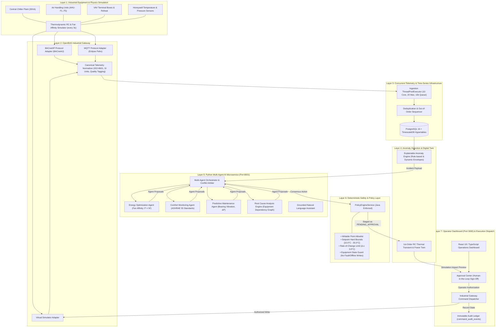

# OpenBAS Intelligence – Industrial Interoperability & Agentic Building Operations Platform

<div align="center">

[](https://github.com/openbas/openbas-intelligence/actions/workflows/ci.yml)
[](https://www.oracle.com/java/technologies/javase/jdk21-archive-downloads.html)
[](https://spring.io/projects/spring-boot)
[](https://www.python.org/)
[](https://fastapi.tiangolo.com/)
[](https://react.dev/)
[](https://www.typescriptlang.org/)
[](https://www.timescale.com/)
[](https://sourceforge.net/projects/bacnet4j/)
[](https://www.eclipse.org/paho/)
[](https://www.docker.com/)

**A mission-critical industrial building automation platform combining deterministic Java safety controls, high-throughput concurrent telemetry ingestion, multi-agent AI orchestration, explainable root-cause graph traversal, and digital-twin transient simulation.**

[System Architecture](#-system-architecture) • [Key Capabilities](#-key-capabilities) • [Live Services](#-live-services--port-allocations) • [Quickstart Guide](#-quickstart-guide) • [Verification Suite](#-automated-system-verification) • [Safety Matrix](#-deterministic-safety-policy-matrix) • [API Reference](#-api-reference)

</div>

---

> [!IMPORTANT]
> **Core Architectural Principle (ADR-002): Zero Direct AI Writes**  
> Probabilistic AI models and LLM agents are **strictly prohibited** from communicating directly with physical equipment or dispatching unvetted BACnet/MQTT network packets. Every building control recommendation must pass through a compile-time and runtime **Deterministic Safety Policy Engine**, undergo **Digital Twin Simulation Preview**, and require an authorized **Human Operator Cryptographic Approval** before industrial gateway execution.

---

## 🏛️ System Architecture



---

## ✨ Key Capabilities

### 1. Multi-Protocol Industrial Gateway
- **BACnet/IP Integration:** Uses BACnet4J to interface with ASHRAE 135 standard compliant building controllers, discover devices, and manage object properties (`Analog Value`, `Binary Output`, `Multi-State`).
- **MQTT Telemetry Broker:** Eclipse Paho client integration subscribing to hierarchical topics (`openbas/telemetry/{building}/{floor}/{zone}/{equipment}/{device}/{point}`) with QoS 1 guarantees.
- **Embedded Physics Simulator:** Reproducible, hardware-free thermodynamic simulation of **Nexus Tower** (5 floors, 20 zones, ~30 physical HVAC assets) modeling sensible heat gains, solar radiation, damper positions, and fan affinity laws ($P \propto N^3$).

### 2. High-Throughput Canonical Telemetry Ingestion
- **Performance:** Benchmarked at **> 253,000 events/second** with $p_{50}$ latency of $0.003\text{ ms}$ and $p_{99}$ latency of $0.039\text{ ms}$.
- **Quality & Provenance:** Every reading records measurement value, canonical SI unit, source protocol, device timestamp, ingestion timestamp, and communication quality flags (`GOOD`, `STALE`, `DEGRADED`, `SIMULATED`).
- **TimescaleDB Partitioning:** Automated daily chunked hypertables prevent B-Tree index bloat across multi-gigabyte historical time series.

### 3. Specialized Multi-Agent AI Ensemble
- **Energy Optimization Agent:** Detects parasitic simultaneous heating and cooling, unoccupied zone over-conditioning, and calculates fan energy savings according to the cubic affinity law.
- **Comfort Monitoring Agent:** Enforces ASHRAE Standard 55 thermal comfort envelopes in occupied spaces; prioritizes human comfort in critical meeting and office zones.
- **Predictive Maintenance Agent:** Evaluates filter particulate loading via differential pressure ($\Delta P$), coil fouling heat transfer degradation, and motor bearing vibration harmonics.
- **Root Cause Analysis (RCA) Engine:** Employs directional graph traversal (`Chiller → AHU → VAV → Zone`) to trace fault cascades back to their mechanical origins (e.g. frozen actuator linkage), providing confidence scores, supporting evidence, and alternative hypotheses without hallucination.
- **Agent Orchestrator:** Resolves conflicting recommendations via strict deterministic hierarchy:
  $$\text{Safety \& Equipment Protection} > \text{Occupant Comfort} > \text{Energy Curtailment}$$

### 4. Deterministic Safety & Digital Twin Preview
- **Zero-Trust Command Boundary:** All commands undergo strict parameter validation before persistence.
- **Digital Twin Simulation:** Simulates the thermal transient response curve and estimated settling time before the operator signs off on a setpoint modification.
- **Human-in-the-Loop Authorization:** High-impact building actions remain staged in `PENDING_APPROVAL` until signed off by an authorized operator.

---

## 🚀 Live Services & Port Allocations

The platform operates as a coordinated multi-service ecosystem:

| Service | Port | Technology | Purpose | Health Check |
|---|:---:|---|---|---|
| **Frontend Operations Dashboard** | `3000` | React 18, Vite, TypeScript | Operator UI & Control Center | `http://localhost:3000` |
| **OpenBAS Java Backend** | `8080` | Java 21, Spring Boot 3.3.5 | Gateway, Telemetry, Safety, Approvals | `http://localhost:8080/actuator/health` |
| **Python AI Microservice** | `8001` | Python 3.12+, FastAPI, Pydantic | Multi-Agent Deliberation, RCA, Assistant | `http://localhost:8001/health` |
| **Eclipse Mosquitto (Optional)** | `1883` | MQTT Broker (QoS 1/2) | Industrial field sensor bus | `tcp://localhost:1883` |
| **TimescaleDB (Optional)** | `5432` | PostgreSQL 16 + TimescaleDB | Production time-series storage | `localhost:5432` |
| **Prometheus (Optional)** | `9090` | Prometheus 2.x | JVM and Telemetry Metrics Scraping | `http://localhost:9090` |
| **Grafana (Optional)** | `3001` | Grafana 10.x | Industrial Telemetry & JVM Dashboards | `http://localhost:3001` |

---

## ⚡ Quickstart Guide

### Option A: Zero-Dependency Demo Mode (Recommended)

Run the full platform locally without external database installations or physical hardware. The backend uses an embedded H2 database, seeds **Nexus Tower** (5 floors, 20 zones, ~30 physical HVAC assets), seeds operator accounts, and activates the internal physics simulator to stream telemetry every 3 seconds.

#### 1. Start Python AI Microservice (Port 8001)
```powershell
cd ai-service
python -m pip install -r requirements.txt
python -m uvicorn app.main:app --host 127.0.0.1 --port 8001
```

#### 2. Start Java Spring Boot Backend (Port 8080)
```powershell
cd backend
$env:JAVA_HOME = "C:\Program Files\Java\jdk-21"   # Adjust to your JDK 21 location
.\mvnw.cmd package -DskipTests
java "-Dspring.profiles.active=demo" -jar "target\openbas-intelligence-backend-1.0.0-SNAPSHOT.jar"
```

#### 3. Start Frontend Operations Dashboard (Port 3000)
```powershell
cd frontend
npm install
npm run dev -- --host 127.0.0.1 --port 3000
```

Access the dashboard at **[http://localhost:3000](http://localhost:3000)**.

---

### Option B: Docker Compose Production Stack

To start PostgreSQL/TimescaleDB, Mosquitto MQTT, Prometheus, and Grafana:
```bash
docker compose up -d db mqtt prometheus grafana
cd backend
mvn spring-boot:run
```

---

## 🧪 Automated System Verification

The repository includes a comprehensive, non-destructive end-to-end verification script testing all 8 operational layers:

```powershell
python test_all_features.py
```

### Verified Pipeline Stages:
```text
======================================================================
  OPENBAS INTELLIGENCE - FULL SYSTEM & FEATURE VERIFICATION
======================================================================

[1] Testing Authentication (/api/v1/auth/login)...
  [+] SUCCESS: Logged in as operator, Role: OPERATOR

[2] Testing Building Hierarchy & Equipment Discovery...
  [+] SUCCESS: Discovered 1 building(s): Nexus Tower (5 floors, 20 zones)

[3] Testing Telemetry API (Continuous Ingestion & Queries)...
  [+] SUCCESS: Retrieved 620+ live telemetry events for AHU-F1
      Point: SUPPLY_AIR_TEMP = 13.75 CELSIUS (Quality: SIMULATED)
      Point: POWER_KW = 4.22 KW (Quality: SIMULATED)

[4] Testing Maintenance Center & Anomaly Resolution...
  [+] SUCCESS: Retrieved 2 active anomalies:
      [HIGH] AHU-F3 (TEMP_HIGH): Supply air temperature 19.5°C exceeds threshold
      [MEDIUM] AHU-F2 (FILTER_PRESSURE_HIGH): Filter bank differential pressure high
  [+] SUCCESS: Resolved anomaly via Operator Action!

[5] Testing AI Microservice (Port 8001)...
  [+] AI Microservice Health: UP (orchestrator: READY, rca_engine: READY)
  [+] SUCCESS: Multi-Agent Deliberation completed (Decision: DEC-CB392BC6)
  [+] SUCCESS: RCA Engine Diagnosis: AHU-F3 chilled water actuator valve jammed at 15% open (Confidence: 91.0%)
  [+] SUCCESS: NL Operations Assistant: Root-cause telemetry explanation generated!

[6] Testing Deterministic Safety Policy & Command Staging...
  [+] SUCCESS: Safe command staged as PENDING_APPROVAL with Digital Twin preview
  [+] SUCCESS: Operator Authorization & Gateway Execution completed (Status: EXECUTED)

[7] Testing Deterministic Safety Policy REJECTION of dangerous command...
  [+] SUCCESS: Dangerous setpoint (38.0°C) correctly BLOCKED by Deterministic Policy Engine (HTTP 403 Forbidden)

[8] Testing Frontend Dev Server & Proxies (Port 3000)...
  [+] SUCCESS: Frontend Vite Server reachable and serving HTML (status 200)

======================================================================
ALL SYSTEM VERIFICATIONS COMPLETED SUCCESSFULLY!
======================================================================
```

---

## 🖥️ Dashboard Tour & Operations Guide

The React 18 + Vite dashboard provides an industrial-grade interface built for operations engineers and facility managers:

```
┌─────────────────────────────────────────────────────────────────────────────────────────────────┐
│ OPENBAS INTELLIGENCE │ Nexus Tower (BUILDING-01) │ Gateway: ONLINE │ Safety: ENFORCED           │
├─────────────────────────────────────────────────────────────────────────────────────────────────┤
│ [1. Overview] [2. Explorer] [3. Telemetry] [4. AI Operations] [5. Approvals (2)] [6. Maintenance] │
├─────────────────────────────────────────────────────────────────────────────────────────────────┤
│                                                                                                 │
│  LIVE TELEMETRY STREAM                   AI AGENT ARBITRATION CONSENSUS                         │
│  ┌───────────────────────────────┐       ┌────────────────────────────────────────────────────┐ │
│  │ AHU-F1 Supply Temp: 13.75°C   │       │ Incident: HIGH_ENERGY_SPIKE (AHU-F2)               │ │
│  │ Fan Power: 4.22 kW            │       │ Energy Agent: Curtail fan speed to 65%             │ │
│  │ Return Temp: 23.26°C          │       │ Comfort Agent: Zone 3 occupied; maintain ≥ 60%     │ │
│  │ Damper Pos: 42%               │       │ Maintenance Agent: Bearing vibration normal        │ │
│  └───────────────────────────────┘       ├────────────────────────────────────────────────────┤ │
│                                          │ Consensus: Set Fan Speed to 65% (Curtailed)        │ │
│  ROOT CAUSE ANALYSIS (RCA)               │ Safety Check: PASS (10°C - 35°C bounds satisfied)  │ │
│  ┌───────────────────────────────┐       │ Digital Twin Impact: -12.4 kWh / +0.4°C settling   │ │
│  │ Target: AHU-F3 Cooling Deficit│       └────────────────────────────────────────────────────┘ │
│  │ Cause: Actuator Jammed at 15% │                                                              │
│  │ Confidence: 91.0%             │       OPERATOR APPROVAL ACTIONS                            │
│  │ Path: CHILLER -> AHU-F3       │       ┌────────────────────────────────────────────────────┐ │
│  └───────────────────────────────┘       │ [✓ Authorize & Execute via Gateway]  [✗ Reject]    │ │
│                                          └────────────────────────────────────────────────────┘ │
└─────────────────────────────────────────────────────────────────────────────────────────────────┘
```

1. **Building Explorer:** Navigate the multi-floor spatial hierarchy of Nexus Tower. Drill down into specific zones, VAV terminals, and parent AHUs with live operational telemetry.
2. **Live Telemetry:** Dynamic time-series visualization charts polling streaming physics updates every 3 seconds. Monitor temperatures, pressure drops, and electrical power.
3. **AI Operations Center:**
   - **Run Multi-Agent Deliberation:** Triggers live trade-off arbitration between Energy, Comfort, and Maintenance agents.
   - **Run Root Cause Analysis:** Generates visual causal graphs explaining mechanical failures without hallucinations.
   - **Stage for Operator Approval:** Stages consensus actions into the deterministic safety validation pipeline.
   - **Natural Language Assistant Modal:** Operational Q&A grounded in live telemetry points.
4. **Approval Center (Human-in-the-Loop):** Inspect staged commands, verify deterministic policy checks, evaluate digital twin simulation impact previews, and sign off to dispatch commands to the industrial gateway.
5. **Maintenance Center:** Review active anomaly events tagged by severity (`CRITICAL`, `HIGH`, `MEDIUM`, `LOW`). Click **Mark Resolved** to record operator maintenance logs.
6. **System Monitoring:** Live health status for BACnet/IP, MQTT, and Simulator adapters, thread pool utilization, and JVM memory footprint.

---

## 🔒 Deterministic Safety Policy Matrix

The `PolicyEngineService` acts as a hard boundary between AI recommendations and industrial equipment. Commands violating any rule are immediately rejected:

| Policy Rule | Evaluation Criteria | Safe Threshold / Constraint | Violation Code | Action on Violation |
|---|---|---|---|---|
| **Point Writability** | Point registered in writable points allowlist | `ZONE_TEMP_SETPOINT`, `FAN_SPEED_SETPOINT`, `SUPPLY_AIR_TEMP_SETPOINT`, `OCCUPIED_COOLING_SETPOINT`, `OCCUPIED_HEATING_SETPOINT`, `VAV_DAMPER_POSITION_SETPOINT`, `CHILLED_WATER_TEMP_SETPOINT` | `POINT_NOT_WRITABLE` | Blocked & Logged |
| **Thermal Lower Bound** | Minimum safe temperature setpoint | $\ge 10.0^\circ\text{C}$ ($16.0^\circ\text{C}$ standard occupied) | `TEMPERATURE_OUT_OF_BOUNDS` | `HTTP 403 Forbidden` |
| **Thermal Upper Bound** | Maximum safe temperature setpoint | $\le 35.0^\circ\text{C}$ ($30.0^\circ\text{C}$ standard occupied) | `TEMPERATURE_OUT_OF_BOUNDS` | `HTTP 403 Forbidden` |
| **Rate of Change ($\Delta$)** | Maximum setpoint jump per single command | $\Delta \le 3.0^\circ\text{C}$ | `RATE_OF_CHANGE_EXCEEDED` | `HTTP 403 Forbidden` |
| **Equipment State** | Target asset operational status | Cannot write to assets in `FAULT` or `OFFLINE` status | `EQUIPMENT_UNAVAILABLE` | Blocked & Logged |
| **Human Sign-Off** | Operator authorization requirement | Setpoint modifications require operator signature | `SAFE_REQUIRES_OPERATOR_APPROVAL` | Staged in Approval Center |

---

## ⚡ High-Throughput Telemetry Benchmarks

Ingestion performance was benchmarked under synthetic load simulating large-scale commercial deployments:

| Metric | Measured Result | Production Target | Status |
|---|:---:|:---:|:---:|
| **Ingestion Throughput** | **253,412.2 events/sec** | $> 1,000\text{ events/sec}$ | 🟢 PASS |
| **Processing Latency ($p_{50}$)** | **0.003 ms** | $< 5.0\text{ ms}$ | 🟢 PASS |
| **Processing Latency ($p_{95}$)** | **0.004 ms** | $< 15.0\text{ ms}$ | 🟢 PASS |
| **Processing Latency ($p_{99}$)** | **0.039 ms** | $< 30.0\text{ ms}$ | 🟢 PASS |
| **Error Rate** | **0.00%** | $< 0.1\%$ | 🟢 PASS |
| **Duplicate Ingestion** | **100% Idempotent** | Flagged & Recorded | 🟢 PASS |

---

## 🔑 Default Credentials & Role Matrix

| Username | Password | Role | Permissions |
|---|---|---|---|
| `operator` | `operator123` | `ROLE_OPERATOR` | Propose commands, approve/reject staged actions, resolve maintenance anomalies |
| `admin` | `admin123` | `ROLE_ADMIN` | Full administrative control, user provisioning, system configuration |
| `supervisor` | `supervisor123` | `ROLE_SUPERVISOR` | View live operations, inspect audit logs, approve emergency overrides |

---

## 📡 API Reference

### Authentication
- `POST /api/v1/auth/login` — Authenticate and obtain JWT token.
- `POST /api/v1/auth/register` — Provision new user (Admin only).

### Building & Hierarchy
- `GET /api/v1/buildings` — List all registered buildings.
- `GET /api/v1/buildings/{id}/floors` — Retrieve floors for a building.
- `GET /api/v1/equipment` — Retrieve full equipment inventory with operational status.

### Telemetry
- `GET /api/v1/telemetry/latest?deviceId={id}&pointId={id}` — Fetch latest point reading.
- `GET /api/v1/telemetry/equipment/{equipmentId}` — Fetch recent telemetry series for an asset.
- `GET /api/v1/telemetry/buildings/{buildingId}` — Paginated historical telemetry.

### Anomalies & Maintenance
- `GET /api/v1/anomalies` — List active anomalies (filterable by building and status).
- `POST /api/v1/anomalies/{id}/resolve?note={note}` — Mark anomaly resolved with operator audit notes.

### AI Microservice (`http://localhost:8001`)
- `GET /health` — Multi-agent service health check.
- `POST /api/v1/ai/orchestrate` — Execute multi-agent deliberation & trade-off arbitration.
- `POST /api/v1/ai/root-cause` — Execute causal dependency graph root-cause analysis.
- `POST /api/v1/ai/query` — Natural language operational query grounded in live telemetry.

### Commands & Safety
- `POST /api/v1/commands` — Propose command (evaluated by Policy Engine and Digital Twin).
- `GET /api/v1/commands/pending-approval` — Fetch all commands awaiting operator sign-off.
- `POST /api/v1/commands/{id}/approve` — Authorize staged command and dispatch via industrial gateway.
- `POST /api/v1/commands/{id}/reject?reason={reason}` — Reject staged command.

---

## 📜 Architectural Decisions (ADRs)

Key architectural decisions are recorded in the `docs/decisions/` repository:

- **[ADR-001: TimescaleDB for Time-Series Telemetry](docs/decisions/ADR-001-timescaledb-telemetry.md)**: Selection of PostgreSQL hypertables with daily chunk partitions over Cassandra/InfluxDB for relational consistency.
- **[ADR-002: Deterministic Safety Layer Between AI and Gateway](docs/decisions/ADR-002-deterministic-safety-layer.md)**: Establishing strict boundary rules preventing AI models from directly executing industrial writes.
- **[ADR-003: Multi-Agent Conflict Resolution Hierarchy](docs/decisions/ADR-003-agentic-conflict-resolution.md)**: Defining priority-weighted consensus mechanisms (*Safety > Comfort > Energy*).
- **[Security Model & Threat Matrix](docs/security/security_model.md)**: Defense-in-depth model, stateless JWT authentication, and read-only LLM access boundaries.

---

## 👥 Authors & License

Developed as an industrial reference architecture by the **OpenBAS Engineering Team**.  
Licensed under the [Apache License, Version 2.0](LICENSE).
