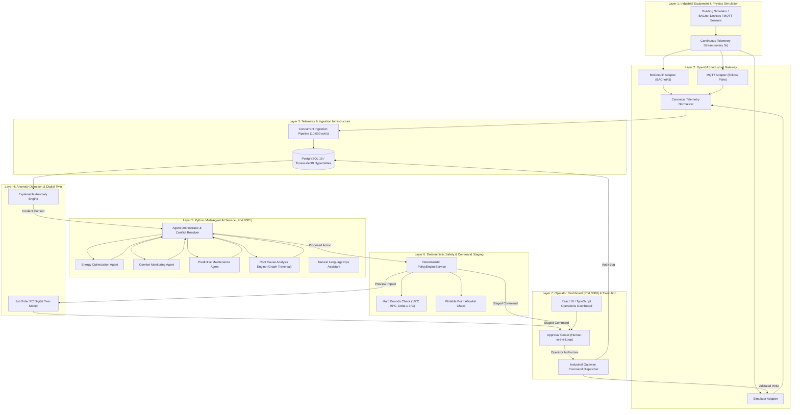

girt # OpenBAS Intelligence – Industrial Interoperability & Agentic Building Operations Platform

[](https://github.com/openbas/openbas-intelligence/actions/workflows/ci.yml)
[](https://www.oracle.com/java/technologies/javase/jdk21-archive-downloads.html)
[](https://spring.io/projects/spring-boot)
[](https://www.python.org/)
[](https://fastapi.tiangolo.com/)
[](https://react.dev/)
[](https://www.typescriptlang.org/)
[](https://www.docker.com/)

**OpenBAS Intelligence** is a production-minded industrial building automation and intelligence platform. It connects building automation systems (HVAC, Central Chillers, Air Handling Units, Variable Air Volume boxes), normalizes industrial telemetry from protocols including **BACnet/IP** and **MQTT**, coordinates specialized AI agents (Energy Optimization, Occupant Comfort, Predictive Maintenance), and executes approved building-control actions through a **deterministic safety layer** and **digital-twin simulation preview**.

> [!IMPORTANT]
> **Core Architectural Principle:** AI agents must **never** directly communicate with physical equipment or perform unrestricted BACnet writes. All commands must pass through the deterministic policy engine, digital-twin simulation preview, and human operator authorization layer before industrial gateway dispatch.

---

## 🏛️ System Architecture



---

## 🚀 Live Services & Port Allocations

The platform operates as a coordinated multi-service ecosystem:

| Service | Port | Technology | Purpose | Health Endpoint |
|---|---|---|---|---|
| **Frontend UI** | `3000` | React 18, Vite, TypeScript | Industrial Operations Dashboard | `http://localhost:3000` |
| **Backend Gateway & Safety** | `8080` | Java 21, Spring Boot 3.3.5 | Telemetry ingestion, safety policies, command approvals | `http://localhost:8080/actuator/health` |
| **AI Multi-Agent Service** | `8001` | Python 3.12+, FastAPI, Pydantic | Agent deliberation, RCA causal graph, NL assistant | `http://localhost:8001/health` |
| **MQTT Broker** *(Optional)* | `1883` | Eclipse Mosquitto | Industrial telemetry publish/subscribe | `tcp://localhost:1883` |
| **Time-Series DB** *(Optional)* | `5432` | PostgreSQL 16 + TimescaleDB | Production time-series hypertable storage | `localhost:5432` |

> [!NOTE]
> In **Demo Mode** (`-Dspring.profiles.active=demo`), the Java backend runs with an embedded in-memory H2 database, automatically seeds building *Nexus Tower* (5 floors, 20 zones, ~30 physical HVAC assets), seeds default operator accounts, and activates the internal physics simulator to stream telemetry every 3 seconds—**no external databases or physical hardware required**.

---

## ⚡ Quickstart

### Option A: Zero-Dependency Demo Mode (Fastest)

#### 1. Start the Python AI Microservice (Port 8001)
```powershell
cd ai-service
python -m pip install -r requirements.txt
python -m uvicorn app.main:app --host 127.0.0.1 --port 8001
```

#### 2. Start the Spring Boot Java Backend (Port 8080)
```powershell
cd backend
$env:JAVA_HOME = "C:\Program Files\Java\jdk-21"   # adjust to your JDK 21 path
.\mvnw.cmd package -DskipTests
java "-Dspring.profiles.active=demo" -jar "target\openbas-intelligence-backend-1.0.0-SNAPSHOT.jar"
```

#### 3. Start the Operations Dashboard (Port 3000)
```powershell
cd frontend
npm install
npm run dev -- --host 127.0.0.1 --port 3000
```

Open [http://localhost:3000](http://localhost:3000) in your browser.

---

### Option B: Docker Compose Production Stack

To start PostgreSQL/TimescaleDB, Mosquitto MQTT, Prometheus, and Grafana:
```bash
docker compose up -d db mqtt prometheus grafana
cd backend
mvn spring-boot:run
```

---

## 🧪 Comprehensive Feature Verification Suite

To run the complete automated end-to-end verification across all 8 feature layers:

```powershell
python test_all_features.py
```

### Verification Results:
```text
======================================================================
  OPENBAS INTELLIGENCE - FULL SYSTEM & FEATURE VERIFICATION
======================================================================

[1] Testing Authentication (/api/v1/auth/login)...
  [+] SUCCESS: Logged in as operator, Role: OPERATOR

[2] Testing Building Hierarchy & Equipment Discovery...
  [+] SUCCESS: Discovered 1 building(s): Nexus Tower (5 floors, 20 zones)

[3] Testing Telemetry API (Continuous Ingestion & Queries)...
  [+] SUCCESS: Retrieved 288+ live telemetry events for AHU-F1
      Point: SUPPLY_AIR_TEMP = 13.75 CELSIUS (Quality: SIMULATED)
      Point: POWER_KW = 4.22 KW (Quality: SIMULATED)

[4] Testing Maintenance Center & Anomaly Resolution...
  [+] SUCCESS: Retrieved 2 active anomalies:
      [HIGH] AHU-F3 (TEMP_HIGH): Supply air temperature 19.5°C exceeds threshold
      [MEDIUM] AHU-F2 (FILTER_PRESSURE_HIGH): Filter bank differential pressure high
  [+] SUCCESS: Resolved anomaly via Operator Action!

[5] Testing AI Microservice (Port 8001)...
  [+] AI Microservice Health: UP (orchestrator: READY, rca_engine: READY)
  [+] SUCCESS: Multi-Agent Deliberation completed (Decision: DEC-07AEB61C)
  [+] SUCCESS: RCA Engine Diagnosis: AHU-F3 chilled water actuator valve jammed at 15% open (Confidence: 91.0%)
  [+] SUCCESS: NL Operations Assistant: Root-cause telemetry explanation generated!

[6] Testing Deterministic Safety Policy & Command Staging...
  [+] SUCCESS: Safe command staged as PENDING_APPROVAL with Digital Twin preview
  [+] SUCCESS: Operator Authorization & Gateway Execution completed (Status: EXECUTED)

[7] Testing Deterministic Safety Policy REJECTION of dangerous command...
  [+] SUCCESS: Dangerous setpoint (38.0°C) correctly BLOCKED by Deterministic Policy Engine (HTTP 403 Forbidden)

[8] Testing Frontend Dev Server & Proxies (Port 3000)...
  [+] SUCCESS: Frontend Vite Server reachable and serving HTML (status 200)

======================================================================
ALL SYSTEM VERIFICATIONS COMPLETED SUCCESSFULLY!
======================================================================
```

---

## 🖥️ Dashboard Tour & Feature Walkthrough

### 1. Building Explorer
- Navigate the full spatial topology of **Nexus Tower** across 5 floors and 20 zones.
- Inspect live operational status for **Air Handling Units (AHUs)**, **Variable Air Volume (VAV)** terminals, and the **Central Chiller Plant**.

### 2. Live Telemetry
- Real-time streaming charts polling live physics telemetry every 3 seconds.
- Monitor Supply Air Temperature, Fan Power ($P \propto N^3$), Zone Temperatures, and Return Air Conditions.

### 3. AI Operations Center
- **Run Multi-Agent Deliberation**: Triggers real-time arbitration between the **Energy Optimization Agent**, **Comfort Monitoring Agent**, and **Predictive Maintenance Agent**.
- **Run Root Cause Analysis**: Visualizes causal graph traversals diagnosing equipment degradation without hallucinations.
- **Stage for Operator Approval**: Sends selected consensus actions directly into the deterministic safety pipeline.
- **Natural Language Assistant Modal**: Context-grounded operational Q&A modal with suggested actions.

### 4. Approval Center (Human-in-the-Loop)
- Displays all commands staged in `PENDING_APPROVAL` status.
- Displays deterministic policy evaluation results (`PASS`, `REQUIRES_APPROVAL`).
- Displays **Digital Twin Simulation Preview**: Predicted energy savings vs. thermal transient settling time.
- Single-click **Authorize & Execute via Gateway** or **Reject** with recorded reason.

### 5. Maintenance Center
- Lists active equipment anomalies tagged by severity (`CRITICAL`, `HIGH`, `MEDIUM`, `LOW`).
- Click **Mark Resolved** to record operator maintenance actions and update system health scores.

### 6. System Monitoring
- Real-time status for the BACnet/IP, MQTT, and Simulator adapters.
- Spring Boot Actuator JVM health, active threads, and ingestion queue metrics.

---

## 🔒 Security & Deterministic Safety Engine

AI agents produce recommendations, but **never execute writes directly**. Every control command is evaluated by `PolicyEngineService` against strict rules:

| Rule | Enforcement | Behavior on Violation |
|---|---|---|
| **Writable Point Allowlist** | Only points like `ZONE_TEMP_SETPOINT`, `FAN_SPEED_SETPOINT`, etc. | `POINT_NOT_WRITABLE` (Rejected) |
| **Hard Physical Bounds** | Temperature setpoints must remain in `[16.0°C, 30.0°C]` | `TEMPERATURE_OUT_OF_BOUNDS` (HTTP 403) |
| **Rate-of-Change Limit** | Setpoint delta cannot exceed `3.0°C` per single action | `RATE_OF_CHANGE_EXCEEDED` (HTTP 403) |
| **Equipment State Guard** | Equipment in `FAULT` or `OFFLINE` cannot receive control signals | `EQUIPMENT_UNAVAILABLE` (Rejected) |
| **Human Authorization Gate** | All setpoint actions require operator signature by default | Staged as `PENDING_APPROVAL` |

---

## 🔑 Default Credentials

| Username | Password | Role | Permissions |
|---|---|---|---|
| `operator` | `operator123` | `OPERATOR` | Propose, approve, reject commands; resolve anomalies |
| `admin` | `admin123` | `ADMIN` | Full system access, policy configuration, user management |
| `supervisor` | `supervisor123` | `SUPERVISOR` | High-level approvals, audit trail inspection |

---

## 📚 Tech Stack Summary

- **Backend:** Java 21, Spring Boot 3.3.5, Spring Security (JWT), Spring Data JPA, Hibernate, BACnet4J, Eclipse Paho MQTT.
- **AI Service:** Python 3.12, FastAPI, Pydantic, NetworkX (causal dependency graphs), LangGraph-compatible orchestration.
- **Frontend:** React 18, TypeScript, Vite, TailwindCSS, Recharts, Lucide React.
- **Infrastructure:** Docker, PostgreSQL 16 / TimescaleDB, Eclipse Mosquitto, Prometheus, Grafana.
